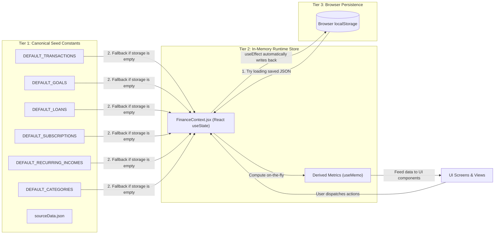
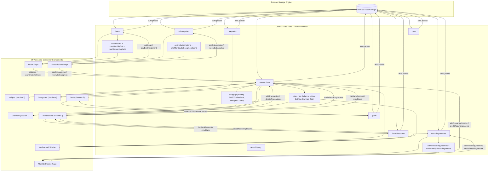
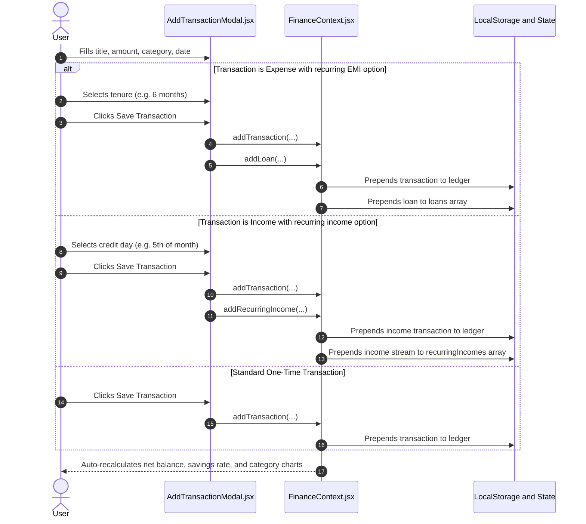
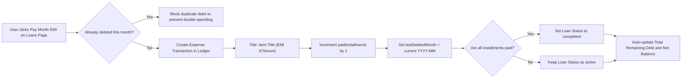
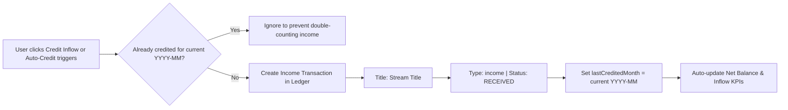
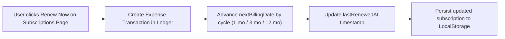
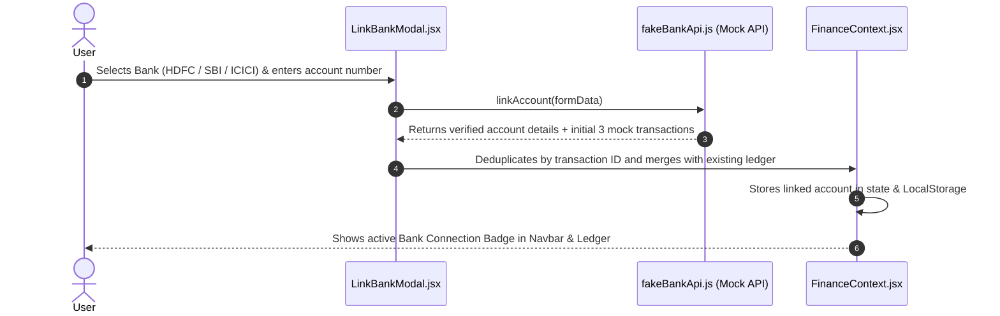

# Paisa Tracker — Comprehensive Codebase & Data Flow Guide

> **Project Mission**: A fast, elegant, student-friendly personal finance application built specifically for the Indian Rupee (`₹` INR) currency ecosystem.

---

## Table of Contents

1. [High-Level System Architecture](#1-high-level-system-architecture)
2. [Data Architecture: Where is the Main Source of Data?](#2-data-architecture-where-is-the-main-source-of-data)
   - [Tier 1: Canonical Seed Constants (Mock Data)](#tier-1-canonical-seed-constants-mock-data)
   - [Tier 2: In-Memory Runtime Source of Truth (React Context)](#tier-2-in-memory-runtime-source-of-truth-react-context)
   - [Tier 3: Browser Persistence Engine (LocalStorage)](#tier-3-browser-persistence-engine-localstorage)
   - [External & Simulated Live Data Sources](#external--simulated-live-data-sources)
3. [Complete Global Data Flow Diagram](#3-complete-global-data-flow-diagram)
4. [Lifecycle Workflows & Action Pipelines](#4-lifecycle-workflows--action-pipelines)
   - [4.1 Adding a Transaction (With EMI or Recurring Income Option)](#41-adding-a-transaction-with-emi-or-recurring-income-option)
   - [4.2 Paying an EMI Installment (One-Click or Auto-Debit)](#42-paying-an-emi-installment-one-click-or-auto-debit)
   - [4.3 Recurring Income Crediting Engine](#43-recurring-income-crediting-engine)
   - [4.4 Subscription Billing & Renewal Pipeline](#44-subscription-billing--renewal-pipeline)
   - [4.5 Open Banking Account Aggregator Simulation](#45-open-banking-account-aggregator-simulation)
5. [The 8 Core Dashboard Views](#5-the-8-core-dashboard-views)
6. [Complete Directory & File Inventory](#6-complete-directory--file-inventory)
7. [Core Invariants (Rules That Never Break)](#7-core-invariants-rules-that-never-break)
8. [Student Project Defense / Technical Viva Q&A](#8-student-project-defense--technical-viva-qa)

---

## 1. High-Level System Architecture

Paisa Tracker runs 100% client-side in the browser. It combines **React 19**, **Tailwind CSS v4**, **Chart.js**, and the native **React Context API** with **LocalStorage** persistence.

### Component Hierarchy & Routing Diagram

```mermaid
%%{init: {"flowchart": {"useMaxWidth": true}, "themeVariables": {"fontSize": "14px"}}}%%
graph TD
    A["main.jsx"] --> B["FinanceProvider (src/context/FinanceContext.jsx)"]
    B --> C["App.jsx (Root State Router)"]

    C -->|view === 'landing'| D["LandingView.jsx"]
    D --> D1["LandingNavbar.jsx"]
    D --> D2["ScrollAnimation.jsx (GSAP Pinning)"]
    D --> D3["GetStartedButton.jsx"]
    D --> D4["Footer.jsx"]

    C -->|view === 'login'| E["Login.jsx (Mock Auth Screen)"]

    C -->|view === 'dashboard'| F["Dashboard Shell"]
    F --> G["Sidebar.jsx (Navigation + Mini KPIs)"]
    F --> H["Navbar.jsx (Search + Bank Badge + Avatar)"]
    F --> I["Active Section Container"]

    I -->|activeSection === 'overview'| J["Section1: Overview"]
    J --> J1["FinanceOsHeader.jsx + WeatherWidget.jsx"]
    J --> J2["MarketTickerStrip.jsx (Live Sensex / Nifty / Gold)"]
    J --> J3["KpiCard.jsx (Net Balance, Inflow, Outflow, Savings)"]
    J --> J4["SpendingDoughnutCard.jsx (Chart.js)"]
    J --> J5["RecentActivityCard.jsx"]
    J --> J6["FinanceNewsCard.jsx"]

    I -->|activeSection === 'transactions'| K["Section2: Transactions Ledger"]
    K --> K1["TransactionItem.jsx"]
    K --> K2["AddTransactionModal.jsx"]
    K --> K3["LinkBankModal.jsx"]
    K --> K4["MonthlyIncomeModal.jsx"]

    I -->|activeSection === 'insights'| L["Section3: Insights & Analytics"]
    L --> L1["CashFlowChartCard.jsx (12-Month Inflow/Outflow Bars)"]

    I -->|activeSection === 'categories'| M["Section4: Categories Breakdown"]
    M --> M1["CategoryListCard.jsx"]
    M --> M2["CategoryDonutCard.jsx"]
    M --> M3["ManageCategoriesModal.jsx"]

    I -->|activeSection === 'goals'| N["Section5: Savings Goals"]
    N --> N1["GoalCard.jsx"]
    N --> N2["AdaptiveGoalPlanner.jsx"]
    N --> N3["CreateGoalModal.jsx"]

    I -->|activeSection === 'loans'| O["LoansPage.jsx (EMI Tracker)"]
    O --> O1["CreateLoanModal.jsx"]

    I -->|activeSection === 'subscriptions'| P["SubscriptionsPage.jsx"]
    P --> P1["CreateSubscriptionModal.jsx"]

    I -->|activeSection === 'income'| Q["IncomePage.jsx (Monthly Income)"]
    Q --> Q1["CreateIncomeModal.jsx"]
```



---

## 2. Data Architecture: Where is the Main Source of Data?

One of the most important concepts to understand and explain in Paisa Tracker is how data originates, moves, updates, and stays saved across browser refreshes.

The data architecture operates in **3 distinct tiers**:



### Tier 1: Canonical Seed Constants (Mock Data)

- **Primary Location**: `src/utils/financeUtils.js` (and reference figures in `src/data/sourceData.json`).
- **What it contains**:
  - `DEFAULT_TRANSACTIONS`: 7 realistic Indian student transactions totaling **₹14,965 inflow**, **₹2,544 outflow**, and **₹12,421 net balance** (_Pocket Money, Stationery, Books, Food, etc._).
  - `DEFAULT_GOALS`: Pre-configured student goal (_MacBook Air M3 - ₹90,000 target_).
  - `DEFAULT_LOANS`: Pre-configured active loan (_MacBook Air M3 No-Cost EMI - ₹60,000 principal, ₹5,000/mo EMI_).
  - `DEFAULT_SUBSCRIPTIONS`: 5 student recurring services (_Spotify Premium ₹119, Netflix ₹199, YouTube Premium ₹149, Google One ₹130, Swiggy One ₹299_).
  - `DEFAULT_RECURRING_INCOMES`: Pre-configured student recurring inflow (_Monthly Pocket Money / Allowance: ₹10,000/month, credit day: 5th_).
  - `DEFAULT_CATEGORIES`: 7 default categories with assigned color tokens (_Food, Shopping, Entertainment, Bills & Utilities, Travel, Investments, Education_).
- **Purpose**: Acts as the immutable baseline. When a user first opens the application or clicks "Reset to Defaults", the app seeds from these constants.

### Tier 2: In-Memory Runtime Source of Truth (React Context)

- **Primary Location**: `src/context/FinanceContext.jsx` (wrapped via `FinanceProvider` around `App.jsx`).
- **How it works**:
  - `FinanceProvider` maintains the live state variables: `transactions`, `goals`, `loans`, `subscriptions`, `recurringIncomes`, `categories`, `linkedAccounts`, `user`, and `searchQuery`.
  - When the app is running, **this state is the single source of truth**. Every component that reads data or triggers mutations reads from and writes to this provider via the `useFinance()` custom hook.
  - Derived calculations (such as `stats` with Net Balance, `categorySpending` with 50/30/20 budget breakdown, `totalMonthlyEmi`, `totalRemainingDebt`, and `totalMonthlyRecurringIncome`) are computed on-the-fly using React's `useMemo`.

### Tier 3: Browser Persistence Engine (LocalStorage)

- **Storage Keys**:
  - `paisatracker_transactions`: Array of ledger entries
  - `paisatracker_goals`: Array of savings goals
  - `paisatracker_loans`: Array of loan & EMI plans
  - `paisatracker_subscriptions`: Array of active/paused recurring subscriptions
  - `paisatracker_recurring_incomes`: Array of recurring monthly inflow streams
  - `paisatracker_categories`: Array of active spending categories
  - `paisatracker_linked_banks`: Array of connected simulated bank accounts
  - `paisatracker_user`: User profile object (`{ username, isAuthenticated }`)
  - `paisatracker_selected_goal`: Currently focused goal ID for the Adaptive Planner
- **Hydration Process (On Page Load)**:
  1. The application executes `loadStoredArray(key, defaultArray)` for each state variable.
  2. If the user has saved data in `localStorage`, it parses and returns that data.
  3. If `localStorage` is empty (first visit) or corrupted, it falls back to the canonical seed constants from Tier 1.
- **Sync Process (On Any Change)**:
  1. Each state slice has a dedicated React `useEffect` hook.
  2. Whenever state changes (e.g. user adds a transaction, pays an EMI, or contributes to a goal), `saveToStorage(key, value)` immediately serializes the updated state to `localStorage`.

### External & Simulated Live Data Sources

1. **Simulated Open Banking API (`src/services/fakeBankApi.js`)**:
   - Simulates the Indian RBI Account Aggregator (AA) framework.
   - Allows users to link mock HDFC, SBI, ICICI, Axis, or Kotak accounts and automatically fetch bank transactions.
2. **Live Indian Market Indices (`src/components/section1/MarketTickerStrip.jsx`)**:
   - Fetches live quotes for BSE Sensex (`^BSESN`), Nifty 50 (`^NSEI`), and Bank Nifty (`^NSEBANK`) via a Vite proxy to Yahoo Finance.
   - Fetches live USD/INR exchange rates from `open.er-api.com` and calculates 24K Gold prices per 10 grams in INR (`₹`).
3. **Live Geolocation Weather (`src/components/section1/WeatherWidget.jsx`)**:
   - Uses the browser Geolocation API to fetch live temperature and weather condition codes from the Open-Meteo REST API.

---

## 3. Complete Global Data Flow Diagram



---

## 4. Lifecycle Workflows & Action Pipelines

### 4.1 Adding a Transaction (With EMI or Recurring Income Option)



### 4.2 Paying an EMI Installment (One-Click or Auto-Debit)



### 4.3 Recurring Income Crediting Engine



### 4.4 Subscription Billing & Renewal Pipeline



### 4.5 Open Banking Account Aggregator Simulation



---

## 5. The 8 Core Dashboard Views

| #     | View Key          | Component File                                       | Description & Purpose                                                                                                                                                                                                                                                                      |
| ----- | ----------------- | ---------------------------------------------------- | ------------------------------------------------------------------------------------------------------------------------------------------------------------------------------------------------------------------------------------------------------------------------------------------ |
| **1** | `'overview'`      | `src/components/section1/section1.jsx`               | **Mission Control Dashboard**: Dynamic time greeting, live weather preview, real-time BSE Sensex/Nifty/Gold ticker strip, 4 core KPI cards (Net Balance, Inflow, Outflow, Savings Rate), Category spending doughnut chart, last 5 ledger transactions preview, and student financial news. |
| **2** | `'transactions'`  | `src/components/section2/section2.jsx`               | **Financial Ledger**: Instant search bar, filter tabs (_All_, _Income_, _Expenses_), individual transaction rows with 50/30/20 bucket badges, delete actions, `AddTransactionModal` (with integrated EMI & recurring toggles), and Open Banking connection button.                         |
| **3** | `'insights'`      | `src/components/section3/section3.jsx`               | **Cash Flow Analytics**: Interactive 12-month bar chart comparing Monthly Inflow vs Outflow, multi-year comparison selector (2024, 2025, 2026), savings rate trends, and chronological multi-month prior history table.                                                                    |
| **4** | `'categories'`    | `src/components/section4/section4.jsx`               | **Category Spending Breakdown**: Evaluates spending against the 50/30/20 budget rule (50% Needs, 30% Wants, 20% Savings), interactive category donut chart, category progress bars, and modal to add/remove custom categories.                                                             |
| **5** | `'goals'`         | `src/components/section5/section5.jsx`               | **Savings Goals & Adaptive Planner**: Target amounts, deadline countdowns, one-click deposits, and the `AdaptiveGoalPlanner` algorithm which dynamically calculates the daily micro-savings pace required to hit student goals on time.                                                    |
| **6** | `'loans'`         | `src/components/loans/LoansPage.jsx`                 | **EMI & Debt Payoff Center**: Dedicated page for gadget, education, and personal loans. Tracks principal, interest, monthly EMI, tenure progress bars, and one-click manual EMI payments with duplicate-debit guards.                                                                      |
| **7** | `'subscriptions'` | `src/components/subscriptions/SubscriptionsPage.jsx` | **Recurring Bills & App Subscriptions**: Tracks streaming (Spotify, Netflix), cloud (Google One), and utility subscriptions. Calculates monthly and annual spend run-rate, days until renewal, and category breakdown.                                                                     |
| **8** | `'income'`        | `src/components/income/IncomePage.jsx`               | **Monthly Recurring Income Engine**: Dedicated page for predictable student inflows (allowances, internship stipends, freelance retainers, scholarships). Includes monthly deposit schedule radar and commitments coverage ratio.                                                          |

---

## 6. Complete Directory & File Inventory

```
src/
├── main.jsx                     # Vite application entry point; wraps App with FinanceProvider
├── App.jsx                      # Top-level state-based router ('landing' | 'login' | 'dashboard')
├── index.css                    # Global Tailwind CSS v4 directives (@import "tailwindcss")
│
├── context/
│   ├── FinanceContext.jsx       # Central state store (Ledger, Loans, Subscriptions, Goals, Auth)
│   ├── financeContextInstance.js# React.createContext() instance singleton
│   └── useFinance.js            # Custom hook exporting the context safely
│
├── hooks/
│   ├── useTransactionFilters.js # Filters transactions by tab ('All'|'Income'|'Expenses') and search query
│   ├── useCashFlowMetrics.js    # Aggregates 12-month inflow/outflow, savings rates, and multi-year data
│   └── useCategoryFilter.js     # Categorizes spending by timeframe ('This Month'|'Last Month'|'All Time')
│
├── utils/
│   ├── financeUtils.js          # Pure helpers: formatRupee(₹), formatDatePretty(), and default seed data
│   └── goalAdaptiveUtils.js     # Calculates micro-savings pace and daily burn for savings goals
│
├── services/
│   └── fakeBankApi.js           # Realistic asynchronous simulated Indian Open Banking API
│
├── lib/
│   └── utils.js                 # cn() classnames helper combining clsx and tailwind-merge
│
├── data/
│   └── sourceData.json          # Reference JSON dataset defining initial portfolio baseline
│
└── components/
    ├── common/
    │   ├── CoinLogo.jsx         # Custom brand logo icon with golden glow
    │   └── KpiCard.jsx          # Reusable KPI metric card with title, value, subtitle, and icon
    │
    ├── ui/                      # Modular UI component layer (shadcn/ui inspired primitives)
    │   ├── button.jsx           # Customizable button with variants ('default', 'outline', etc.)
    │   ├── card.jsx             # Card container, header, title, and content wrappers
    │   ├── dialog.jsx           # Accessible modal dialog with backdrop and escape-key handling
    │   ├── input.jsx            # Styled text and number inputs
    │   ├── select.jsx           # Dropdown selection primitive
    │   ├── badge.jsx            # Status and tag pill badges
    │   ├── tabs.jsx             # Tab switching primitive (All / Income / Expense)
    │   └── progress.jsx         # Animated progress bar for goals and loan repayments
    │
    ├── landing/                 # High-converting landing page
    │   ├── LandingView.jsx      # Landing hero section, stats preview, and interactive buttons
    │   ├── LandingNavbar.jsx    # Top landing navigation bar
    │   ├── ScrollAnimation.jsx  # GSAP ScrollTrigger timeline animation
    │   ├── GetStartedButton.jsx # Primary call-to-action button
    │   └── Footer.jsx           # Student footer & links
    │
    ├── login/
    │   └── login.jsx            # Minimalist credentials screen with quick student demo login
    │
    ├── navbar/
    │   └── navbar.jsx           # Top app bar with instant global search, bank indicator, and user avatar
    │
    ├── sidebar/
    │   └── sidebar.jsx          # Responsive collapsible sidebar with active badges & monthly spend meter
    │
    ├── section1/                # DASHBOARD: Overview
    │   ├── section1.jsx         # Overview grid orchestrator
    │   ├── FinanceOsHeader.jsx  # Dynamic greeting based on time of day
    │   ├── WeatherWidget.jsx    # Live location weather preview
    │   ├── MarketTickerStrip.jsx# Live Sensex, Nifty 50, and 24K Gold prices
    │   ├── SpendingDoughnutCard.jsx # Category spending donut chart
    │   ├── RecentActivityCard.jsx # Last 5 transactions ledger preview
    │   └── FinanceNewsCard.jsx  # Student financial tips and curated headlines
    │
    ├── section2/                # DASHBOARD: Transactions
    │   ├── section2.jsx         # Ledger view with search bar, filter tabs, and action buttons
    │   ├── TransactionItem.jsx  # Individual transaction row with bucket tag and delete action
    │   ├── AddTransactionModal.jsx# Form to record income/expense, with EMI & recurring options
    │   └── LinkBankModal.jsx    # Connect simulated Indian banks (HDFC, SBI, ICICI, etc.)
    │
    ├── section3/                # DASHBOARD: Insights
    │   ├── section3.jsx         # Analytics view with summary KPI cards
    │   └── CashFlowChartCard.jsx# Interactive 12-month bar chart comparing inflow vs outflow
    │
    ├── section4/                # DASHBOARD: Categories
    │   ├── section4.jsx         # Category analytics view with 50/30/20 breakdown
    │   ├── CategoryListCard.jsx # Ranked list of expense categories with progress bars
    │   ├── CategoryDonutCard.jsx# Interactive category spending donut
    │   └── ManageCategoriesModal.jsx # Add / delete custom expense categories
    │
    ├── section5/                # DASHBOARD: Goals
    │   ├── section5.jsx         # Savings goals view
    │   ├── GoalCard.jsx         # Goal progress card with deposit button and percentage ring
    │   ├── AdaptiveGoalPlanner.jsx # AI-style pace calculator (Daily micro-saving target)
    │   ├── CreateGoalModal.jsx  # Form to create new savings goal
    │   └── GoalEmptyState.jsx   # Friendly empty state when no goals exist
    │
    ├── loans/                   # DASHBOARD: Loans & EMI Tracker
    │   ├── LoansPage.jsx        # Complete Loan & EMI payoff dashboard
    │   └── CreateLoanModal.jsx  # Add new Gadget / Education / Personal loan EMI
    │
    ├── subscriptions/           # DASHBOARD: Subscriptions
    │   ├── SubscriptionsPage.jsx# Streaming / Cloud / App recurring subscription manager
    │   └── CreateSubscriptionModal.jsx # Add new recurring subscription
    │
    └── income/                  # DASHBOARD: Recurring Monthly Income
        ├── IncomePage.jsx       # Dedicated Monthly Recurring Income Page
        ├── CreateIncomeModal.jsx# Form & student presets to add/edit income streams
        └── MonthlyIncomeModal.jsx# Quick modal manager
```

---

## 7. Core Invariants (Rules That Never Break)

1. **₹ (INR) Currency Invariant**:
   - Every single monetary figure is formatted with the Indian Rupee symbol `₹`.
   - Never use `$`, `€`, or unformatted raw numbers in text, charts, or mock data.
   - Standard helper: `formatRupee(amount)` from `src/utils/financeUtils.js`.

2. **Tailwind CSS v4 Standard**:
   - Uses `@tailwindcss/vite` with `@import "tailwindcss";` in `src/index.css`.
   - No legacy `tailwind.config.js` or `postcss.config.js` files are needed.

3. **In-Memory View Routing**:
   - `App.jsx` handles page views cleanly using React state (`view`: `'landing' | 'login' | 'dashboard'`).
   - Keeps the bundle lightweight and eliminates external router dependencies.

4. **GSAP Cleanup Discipline**:
   - All GSAP scroll animations use `gsap.context(() => { ... })` with `return () => ctx.revert()`.
   - Prevents memory leaks and orphaned scroll listeners.

5. **Safe LocalStorage Hydration**:
   - Every state slice uses `loadStoredArray()` or `loadStoredItem()` with `try/catch`.
   - Missing or cleared storage safely loads default seed data instead of crashing.

---

## 8. Student Project Defense / Technical Viva Q&A

### Q1: Where does the app's data come from, and where does it go when a user adds a transaction?

> **Answer**: Data starts from default seed constants in `src/utils/financeUtils.js`. On first launch, `FinanceProvider` loads these into React state and serializes them into browser `localStorage`. When a user adds a transaction, `addTransaction` updates the in-memory React state, triggering an instant UI re-render and recalculating all `useMemo` financial metrics. Finally, a React `useEffect` automatically writes the updated array back into `localStorage`.

### Q2: Why did you choose React Context API over Redux or Zustand?

> **Answer**: For a client-side personal finance tracker of this scale, Context API is built directly into React, requiring **zero extra dependencies** or bundle overhead. Coupled with custom domain hooks (`useFinance`, `useTransactionFilters`, `useCashFlowMetrics`), it provides clean modularity, centralized state, and straightforward debugging that any developer can understand and explain.

### Q3: How does the app prevent duplicate debits for EMI and recurring income?

> **Answer**: Each loan and recurring income tracks a `lastDebitedMonth` / `lastCreditedMonth` string formatted as `YYYY-MM`. When the user or system triggers a payment or credit, the handler checks if `lastDebitedMonth === currentMonthKey`. If true, the action is ignored, guaranteeing that the ledger is never debited or credited twice for the same calendar month.

### Q4: How are calculations like the 50/30/20 budget and savings rate optimized?

> **Answer**: Derived metrics are wrapped in React's `useMemo` hook with `[transactions]` as their dependency. This ensures that expensive array iterations and percentage calculations only execute when transactions are actually added, modified, or deleted—leaving normal UI re-renders instantaneous.

### Q5: How does the application handle offline use and data persistence?

> **Answer**: The application is 100% functional offline because all state persistence relies on browser `localStorage`. No server roundtrips or database connections are required for core features like transaction logging, loan payoff calculations, or savings goal tracking.
